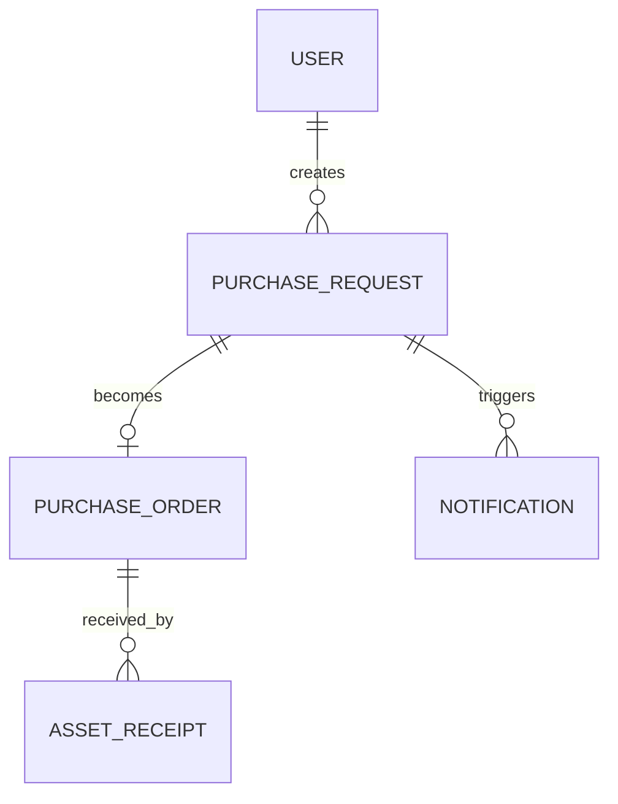

# Data Schema - CSI204-POMS

The backend uses local JSON files instead of a relational database. The files are stored in `poms-backend/dummy` and `poms-backend/api/Auth/users.json`.

## Files

| File | Purpose |
| --- | --- |
| `dummy/pr.json` | Purchase request records keyed by PR ID |
| `dummy/po.json` | Purchase order records keyed by PO ID |
| `dummy/asset.json` | Asset receipt records keyed by receipt ID |
| `dummy/finance.json` | Finance dashboard, debt, and monthly item data |
| `dummy/db.json` | Normalized sample dataset for PR, PO, receipt, and notification data |
| `api/Auth/users.json` | Application users for authentication and authorization |

## `users.json`

| Field | Type | Notes |
| --- | --- | --- |
| `userId` | String | User ID such as `U001` |
| `username` | String | Login username |
| `password` | String | bcrypt hash |
| `display_name` | String | Name shown in UI |
| `role` | String | User role, for example `Admin` |

## Purchase Requests (`pr.json`)

Top-level object keyed by purchase request ID, for example `PR001`.

| Field | Type | Notes |
| --- | --- | --- |
| `company` | String | Company name |
| `department` | String | Requesting department |
| `position` | String | Requester position |
| `createdBy` | String | Requester name or user ID |
| `phone` | String | Contact phone |
| `createdAt` | DateTime | Created timestamp |
| `requestDate` | Date | Request date |
| `requiredDate` | Date | Required date |
| `description` | String | Request description |
| `status` | String | `Pending`, `Approved`, `Rejected`, etc. |
| `totalPrice` | Number | Total request amount |
| `approver` | String | Approver name/user |
| `purchasingOfficer` | String | Purchasing officer |
| `approveDate` | DateTime | Approval timestamp |
| `isApproved` | Boolean | Approval flag |
| `item` | Array | Request line items |

### Purchase Request Item

| Field | Type | Notes |
| --- | --- | --- |
| `itemId` | String | Line item ID |
| `description` | String | Item description |
| `unit` | String | Unit of measure |
| `unitPrice` | Number | Unit price |
| `quantity` | Number | Quantity requested |
| `remarks` | String | Extra notes |
| `totalItemPrice` | Number | `unitPrice * quantity` |

## Purchase Orders (`po.json`)

| Field | Type | Notes |
| --- | --- | --- |
| `purchaseOrderId` | String | PO ID |
| `purchaseRequestId` | String | Related PR ID |
| `sellerName` | String | Vendor name |
| `sellerContact` | String | Vendor contact |
| `sellerAddress` | String | Vendor address |
| `paymentTerms` | String | Payment terms |
| `status` | String | Current PO status |
| `items` | Array | PO line items |
| `trackingNumber` | String | Tracking/reference number |
| `approvalStatus` | Object | Approval metadata |

## Asset Receipts (`asset.json`)

| Field | Type | Notes |
| --- | --- | --- |
| `receiptId` | String | Receipt ID |
| `purchaseOrderId` | String | Related PO ID |
| `purchaseRequestId` | String | Related PR ID |
| `receivedDate` | Date | Receive date |
| `referenceNumber` | String | PO/reference number |
| `status` | String | Receipt status |
| `totalReceived` | Number | Total quantity received |
| `items` | Array | Received item lines |

## Finance (`finance.json`)

| Field | Type | Notes |
| --- | --- | --- |
| `financialData.income` | Number | Income summary |
| `financialData.totalProfit` | Number | Profit summary |
| `financialData.expenses` | Number | Expense summary |
| `financialData.debt` | Number | Debt summary |
| `debts[]` | Array | Debt item list |
| `monthlyItems.labels` | String[] | Month labels |
| `monthlyItems.data` | Number[] | Monthly values |

## Relationships

