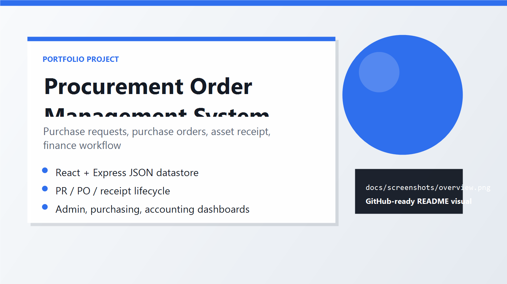

# Procurement Order Management System

Procurement Order Management System (POMS) is a React and Express application for purchase request, purchase order, asset receipt, notification, finance, and user-role workflows.

## Screenshots

<p align="center">
  
</p>

## Features

- Login with JWT and role-based access control.
- Purchase request creation, approval/rejection, and status updates.
- Purchase order creation from approved requests.
- Asset receipt recording and received item tracking.
- Finance dashboard data and debt list.
- Notifications and user management for admins.
- Frontend dashboards for purchasing, administrative, accounting, and admin users.

## Tech Stack

| Layer | Technology |
| --- | --- |
| Frontend | React 19, Vite, React Router, Tailwind CSS, Recharts, SweetAlert2 |
| Backend | Node.js, Express, JSON Web Token, bcryptjs |
| Data store | Local JSON files in `poms-backend/dummy` and `poms-backend/api/Auth/users.json` |

## Project Structure

```text
CSI204-POMS-main/
  poms-backend/
    server.js
    api/
    dummy/             # JSON data store
  poms-frontend/
    src/
```

## Run Locally

```bash
cd poms-backend
npm install
node server.js
```

```bash
cd poms-frontend
npm install
npm run dev
```

Default local URLs:

- Frontend: `http://localhost:5173`
- Backend API: `http://localhost:3000`

## Initial Admin

The backend includes `poms-backend/api/Auth/setup.js` for creating the first admin user in `users.json`.

```bash
cd poms-backend
node api/Auth/setup.js
```

Default generated credentials:

- Username: `admin`
- Password: `admin`

Change this before using the project outside a local demo.

## API Overview

| Base path | Purpose |
| --- | --- |
| `POST /api/auth/login` | Login and receive JWT |
| `/api/users` | User listing, profile, create, update, delete |
| `/api/purchase-requests` | Purchase request CRUD and status changes |
| `/api/purchase-orders` | Purchase order CRUD and status changes |
| `/api/asset-receipts` | Asset receipt CRUD |
| `/api/notifications` | Notification listing and read status |
| `/api/finance` | Finance dashboard data |

## Database / Data Schema

This project currently uses JSON files as a mock database. The structure is documented in `DATABASE_SCHEMA.md`.

## GitHub Notes

Before publishing, keep generated dependencies and local secrets out of Git: `node_modules/`, `.env`, and `dist/`.
